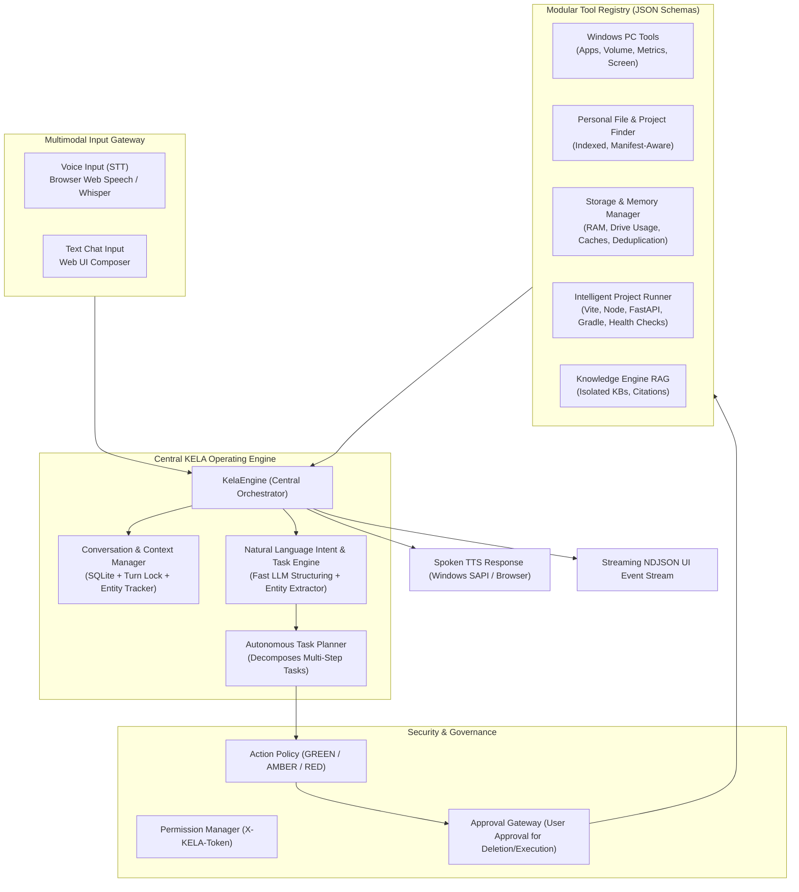

# MASTER SYSTEM AUDIT — KELA AI PLATFORM
## Deep Comprehensive Architectural, Security, and Pipeline Audit
**Project**: KELA — Personal AI Operating Assistant  
**Repository**: `https://github.com/KunalSingh202008/Personal-AI-Assistant.git`  
**Audit Baseline**: Branch `main`, Commit `2c24e80`  
**Date**: November 12, 2026  
**Auditor**: Lead AI Architect, Senior Full-Stack & Windows Automation Engineer  

---

## 1. Executive Git & Repository Audit

### 1.1 Working Tree & Branch Integrity
- **Active Branch**: `main` (tracking `origin/main`).
- **HEAD Commit**: `2c24e80` (*test(phase-3): add json/jsonl parser and empty retrieval non-fabrication tests*).
- **Working Tree State**: Clean; all modified and newly created files from Phases 1, 2, 2.1, and 3 are tracked, committed, and pushed.
- **Git Commit History**:
  - `2c24e80`: Enhanced parser and RAG empty retrieval non-fabrication tests (119/119 tests passing).
  - `699d22d`: Phase 3 Multi-Dataset Knowledge Engine with RAG, isolated KBs, and genuine citations.
  - `eaa647c`: Phase 2.1 Unification of voice conversation with KelaEngine and session persistence.
  - `b4c0770`: Phase 2 Core engine stabilization, provider abstraction, and security hardening.
  - `cd58367` & `e653231`: Phase 1 ESLint resolution, PC process verification, and SAPI/Whisper voice abstraction.

### 1.2 Repository Topology
```
/
├── .kela_knowledge/         # Managed isolated knowledge base datasets (<kb_id>/)
├── backend/
│   ├── action_policy.py     # Action risk classification (GREEN, AMBER, RED)
│   ├── agent.py             # Autonomous coding agent with tool approval loop
│   ├── database.py          # SQLite persistence (conversations, messages, KBs, chunks, FTS5)
│   ├── main.py              # FastAPI application server (port 8001)
│   ├── pc_control/          # Windows automation (apps, audio, power, files, screenshots)
│   ├── core/                # Central intelligence package
│   │   ├── engine.py        # KelaEngine (chat_stream, process_voice_turn)
│   │   ├── provider_manager.py  # Model inference providers (Ollama + Cloud fallback)
│   │   ├── conversation_manager.py # SQLite message/session manager with turn locking
│   │   ├── context_manager.py      # Context window budgeting and preference injection
│   │   ├── prompt_manager.py       # Prompt templates & <untrusted_reference_data> barriers
│   │   ├── tool_registry.py        # Tool schemas and risk policy interface
│   │   └── permission_manager.py   # Origin validation, Host validation, X-KELA-Token
│   ├── knowledge/           # Multi-dataset RAG engine (parsers, chunker, embeddings, engine)
│   ├── orchestrator/        # High-level task planner & autonomy levels (currently isolated)
│   ├── voice/               # Voice router, intent resolver, audio providers (STT/TTS)
│   └── tests/               # 17 test suites (119 automated unit & integration tests)
├── frontend/                # React 18 + TypeScript + Vite UI (port 5175)
│   ├── src/
│   │   ├── App.tsx          # Main workspace panel, tabs, and chat interface
│   │   ├── components/      # Specialized UI views (VoiceAssistant, PCControl, Knowledge, etc.)
│   │   └── types.ts         # Central TypeScript interfaces
└── run_tests.py             # Discovers and runs all 119 unit tests
```

---

## 2. Root Cause Analysis: The Existing Voice Problem (Part 2 Investigation)

### 2.1 Symptoms Observed
1. Microphone captures audio clearly.
2. Speech-to-text accurately transcribes spoken words into the live transcript UI.
3. Only a narrow collection of ~20 exact predefined regex phrases actually execute PC actions (e.g., *"open calculator"*, *"volume up"*, *"find my resume"*).
4. Most natural language requests (e.g., *"Find my Phone Doctor project"*, *"Where did I save my resume?"*, *"Run my project locally"*, *"Check my disk space"*, *"Tell me what happened"*) either:
   - Fall back to a generic 25-word spoken text response without performing any action.
   - Remain completely silent or say *"I am right here with you, Kunal. How can I help next?"*.
5. Contextual follow-up conversation is non-functional (e.g. *"Find Phone Doctor"* $\rightarrow$ *"Run it"* fails because *"it"* is not resolved).

### 2.2 Trace of the Actual Execution Pipeline
```
Microphone (Browser MediaStream)
  ↓
SpeechRecognition (Web Speech API / faster-whisper)
  ↓
POST /api/voice/conversation (with cleanText, conversation_id, turn_id)
  ↓
voice_command_endpoint() in backend/main.py
  ↓
kela_engine.process_voice_turn() in backend/core/engine.py
  ↓
resolve_voice_intent() in backend/voice/router.py   <-- [FAILURE POINT 1: Brittle Regex Filter]
  ↓
execute_voice_action() in backend/voice/router.py  <-- [FAILURE POINT 2: Rigid Predefined Dispatch]
  ↓
provider.generate_chat() without Tools              <-- [FAILURE POINT 3: Blind LLM Fallback]
```

### 2.3 The Three Core Flaws Identified

#### Flaw 1: The Hardcoded Regex Wall (`backend/voice/router.py`)
`resolve_voice_intent()` attempts to parse user intent exclusively via Python `re.search()` patterns:
```python
# Lines 245-298 in backend/voice/router.py
if re.search(r'\b(open camera|camera kholo|webcam kholo)\b', lower): ...
if re.search(r'\b(open youtube|youtube kholo|play youtube)\b', lower): ...
if re.search(r'\b(open (?:the )?(?:browser|chrome|google chrome)|...)\b', lower): ...
if re.search(r'\b(open (?:vs code|vscode|code editor)|code kholo)\b', lower): ...
if re.search(r'\b(find (?:my )?resume|where is my resume|...)\b', lower): ...
```
If an utterance differs even slightly in phrasing, grammar, language mix (Hindi/Hinglish), or refers to a real project (e.g., *"Find Phone Doctor"*), it fails all regexes and hits:
```python
# Line 413 in backend/voice/router.py
return {
    "action": "conversational_ai",
    "fast_path": False,
    "lang": lang,
    "clean_query": clean,
    "needs_llm": True,
    "params": {},
}
```

#### Flaw 2: Blind LLM Fallback Without Tool Access (`backend/core/engine.py`)
When `needs_llm: True` is returned, `KelaEngine.process_voice_turn()` sends the prompt to Ollama with this prompt:
```python
# Lines 401-426 in backend/core/engine.py
voice_system = (
    "You are KELA, an ultra-fast voice assistant for Kunal Singh. "
    "Answer in ONE short, natural spoken sentence (under 25 words). "
    "Never use markdown, lists, code, or quotes."
)
provider.generate_chat(query_messages, options={"temperature": 0.4, "num_predict": 30})
```
**The LLM is passed `tools=None`!**  
The model has **no tools registered**, no schema to invoke PC operations, no file finder tool, no project runner, and no storage auditor. Consequently, the LLM produces a short conversational text string, and the system executes zero computer operations.

#### Flaw 3: Absence of Conversational Context Resolution
When the user says *"Run it"*, there is no Entity/Context Tracker to recognize that the entity in the previous turn was *"Phone Doctor"*. The utterance *"Run it"* fails regex matching, hits the blind LLM fallback, and the LLM responds conversationally without executing the project.

---

## 3. Subsystem Audit & Component Classification

### 3.1 Working Components (MUST BE PRESERVED)
1. **Core AI Engine & Session Persistence (`backend/core/`)**:
   - `ConversationManager`: Thread-safe SQLite persistence, atomic turn locking (`acquire_turn_lock`), message retrieval.
   - `ContextManager`: Safe context budgeting (24,000 chars), preference injection, history pruning.
   - `PromptManager`: Secure prompt assembly and `<untrusted_reference_data>` injection barriers.
   - `ProviderManager`: Unified interface for local Ollama (`qwen2.5-coder:7b`) with health checks, model discovery, and cloud adapter fallback.
2. **Multi-Dataset Knowledge Engine RAG (`backend/knowledge/`)**:
   - Multi-KB isolated storage (`.kela_knowledge/<kb_id>/`).
   - Parsers for PDF (pages), DOCX (tables), XLSX (sheets), CSV, JSON, JSONL, TXT, MD.
   - Hybrid lexical (FTS5) + vector (cosine similarity) Reciprocal Rank Fusion ($k=60.0$).
   - Genuine citation tracking (`page_number`, `sheet_name`).
3. **Security, Auth & Anti-DNS Rebinding (`backend/core/permission_manager.py`)**:
   - `X-KELA-Token` cryptographic token authentication.
   - Origin header and Host header loopback validation.
   - Centralized risk classification (`GREEN`, `AMBER`, `RED`) in `action_policy.py`.
4. **Native Win32 Audio & Telemetry (`backend/pc_control/`)**:
   - Direct Win32 C types for master volume and mute (`endpointvolume`).
   - Direct `GetSystemPowerStatus` and `GlobalMemoryStatusEx` in `<1ms`.
   - Native Windows SAPI TTS (`System.Speech.Synthesis`) with zero audio latency.
   - Chrome `SpeechRecognition` continuous listening, 0ms `isFinal` submission, and instant barge-in.

### 3.2 Incomplete, Broken, or Mocked Components (MUST BE FIXED)
1. **Mocked Process Listing (`backend/pc_control/system_ops.py:72-82`)**:
   - `list_running_processes()` returns a hardcoded mock array (`[{"ProcessName": "chrome", "MemoryMB": 420}, ...]`).
   - Must be replaced with genuine Windows process enumeration with accurate memory working set sizes.
2. **Primitive File Searching (`backend/pc_control/file_search.py`)**:
   - Only searches 3 folders (Downloads, Documents, Desktop) to depth 3 using simple `str in f.lower()`.
   - Cannot detect Git repositories, project root manifests (`package.json`, `pom.xml`, `build.gradle`, `requirements.txt`), date ranges, or file sizes.
   - Rescans disk on every request without indexing or caching.
3. **Missing Storage & Cleanup Intelligence**:
   - No drive capacity or free space breakdown.
   - No project-wise disk usage calculation.
   - No duplicate detection via SHA-256 chunk hashing.
   - No categorized cleanup analyzer (temp files, npm cache, pip cache, build artifacts `node_modules`, `dist`, `__pycache__`).
4. **Missing Project Runner**:
   - No capability to detect technology stacks, find entry points, check port conflicts, start processes, capture logs, or verify HTTP health endpoints.
5. **Tool Registry Fragmentation (`backend/core/tool_registry.py`)**:
   - `tool_registry.py` only registers 5 workspace coding tools (`list_files`, `search_workspace`, `read_file`, `write_file`, `run_command`).
   - PC control tools, file discovery tools, storage tools, and project runner tools are NOT registered as formal tools with JSON schemas.

---

## 4. Architectural Target: Unified Voice & PC Operating System



---

## 5. Security Posture Audit & Hardening Matrix

| Risk Vector | Current State | Required Master Hardening |
|---|---|---|
| **Arbitrary Command Execution** | `run_command` restricted to allowlisted commands in workspace. | Prevent arbitrary natural language from executing raw shell commands; all executions must route through typed tools with explicit arguments and approval. |
| **Destructive File Deletion** | Deletion is possible via python code edits. | Strictly require explicit user approval (AMBER/RED) for all file deletions; move deleted items to Windows Recycle Bin / reversible quarantine rather than permanent wipe. |
| **Path Traversal Attacks** | Handled in `knowledge/parser.py` via `sanitize_filename`. | Enforce `safe_resolve_path()` across all file search, read, write, and project runner modules. Block access to `C:\Windows\System32`, `AppData\Local\Credentials`, etc. |
| **DNS Rebinding & CSRF** | Protected via `validate_origin()` and `validate_host()`. | Maintain strict loopback checking; require `X-KELA-Token` for all mutating endpoints. |
| **Prompt Injection via Documents/Web** | Protected via `<untrusted_reference_data>` security tags. | Maintain injection barriers; ensure external document text is never interpreted as tool-calling directives. |
| **Port Conflicts & Zombie Processes** | Unhandled; starting servers could clash with active services. | Implement managed PID tracking; detect port conflicts prior to startup; allow stopping only processes spawned by KELA. |

---

## 6. Audit Verdict

KELA has a solid, well-tested core foundation (119/119 unit tests passing, robust SQLite persistence, unified session IDs, clean RAG engine). The primary barrier preventing KELA from operating as a true personal assistant is **the rigid regex intent wall in `backend/voice/router.py`** and **the lack of registered tools in `KelaEngine`**. 

By replacing the regex wall with an **LLM-driven intent and entity orchestrator**, registering **modular PC, Project, Storage, and File tools**, and equipping `KelaEngine` with an **interactive clarification/execution loop**, KELA will achieve full natural language voice-to-PC autonomy.
